# Architecture — GraphRAG care plan API

This document describes the **current POC** (Express + Neo4j + Gemini) and a **scalable target** that keeps the same product invariant: the model never invents a treatment, exam, or interval. Plan items come only from the clinic catalog; recurrence and duration come from `Treatment` nodes, not from generated text.

Operational how-to lives in [README.md](README.md). Document authoring rules live in [docs-template.md](docs-template.md) and [AGENTS.md](AGENTS.md).

---

## 1. System context

The API sits between a veterinary client (mobile app, `curl`, later WhatsApp/Telegram) and two backends: a **graph of clinic knowledge** and a **hosted LLM**.

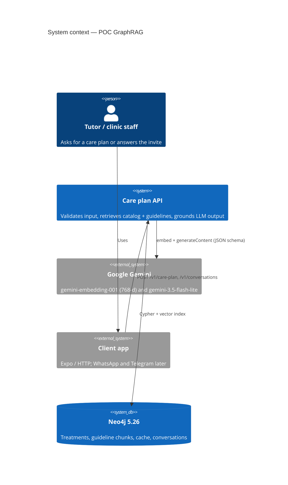

**What the system is allowed to do**

- Choose **ids** that already exist in `api/data/clinica-catalogo.csv`.
- Copy recurrence, interval, and duration from the matching `Treatment`.
- Cite guideline `Source` metadata (title, URL, publisher) retrieved by vector search.
- Invite the tutor and answer questions **only** about items already in the sent plan.

**What the system must not do**

- Invent a product, vaccine, exam, or interval that is not in the catalog.
- Use managed File Search / hosted RAG as the planner (it would hallucinate off-catalog items).
- Treat the LLM as source of truth for schedule fields.

---

## 2. Containers (current POC)

Docker Compose runs three local pieces. Gemini is external. There is no Ollama.

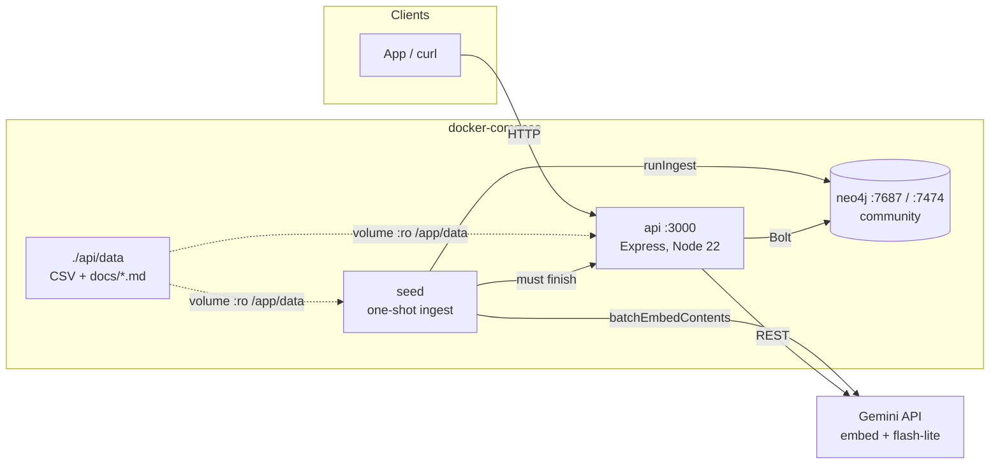

| Container | Role | Scale characteristic |
| --- | --- | --- |
| **api** | HTTP, Zod validation, GraphRAG orchestration, conversation engine, ingest endpoint | One process, pool of 10 Bolt connections |
| **neo4j** | Catalog graph, cosine vector index `guideline_index`, demographic cache, conversation store | Single Community instance, volume `neo4j_data` |
| **seed** | Waits for Neo4j + Gemini, calls `runIngest`, exits | Blocks API start (`service_completed_successfully`) |
| **Gemini** | Embeddings (`RETRIEVAL_QUERY` / `RETRIEVAL_DOCUMENT`, L2-normalized 768-d) and JSON chat | Shared SaaS quota; on the request path |

The API holds **no clinical state in memory**. Knowledge and catalog live in the graph. Tests swap the conversation store for an in-memory map.

---

## 3. Code map

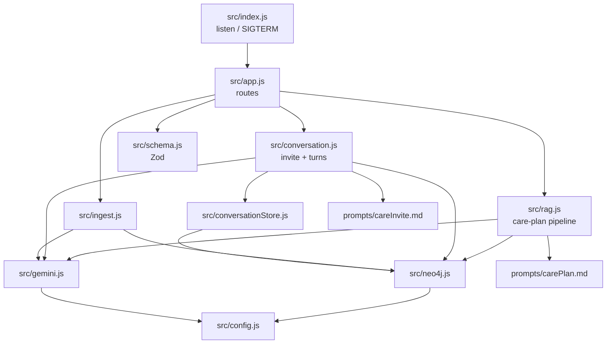

| Path | Responsibility |
| --- | --- |
| `api/src/index.js` | HTTP listen; timeouts disabled (LLM can be slow); close Bolt on shutdown |
| `api/src/app.js` | `/health`, `/v1/care-plan`, `/v1/ingest`, `/v1/conversations` |
| `api/src/rag.js` | Cache → parallel embed + Cypher catalog → vector kNN → LLM ids → ground → describe |
| `api/src/conversation.js` | Start invite; inbound intent → `accepted` / `declined`; RAG on questions |
| `api/src/conversationStore.js` | Neo4j `Conversation`/`Message`; memory store for tests |
| `api/src/ingest.js` | Upsert CSV; hash-skip markdown; chunk >40 chars; invalidate cache |
| `api/src/neo4j.js` | Treatment filter, vector query, `CachedCarePlan` |
| `api/src/gemini.js` | REST `generateContent` + `batchEmbedContents` (batch 16) |
| `api/src/schema.js` | Pet, LLM ids, conversation intake, turn `{ reply, intent }` |
| `api/data/clinica-catalogo.csv` | Allowed menu (stable `id`) |
| `api/data/docs/*.md` | Breed-specific and global guidelines |
| `scripts/harvest-allowlist.mjs` | Prints candidate URLs; does not crawl |

---

## 4. Graph data model

Neo4j is used as **three stores in one**: a small applicability graph, a vector RAG corpus, and a document-ish OLTP store for chats and cache.

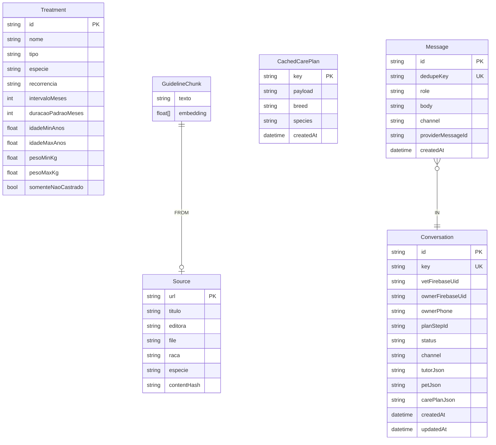

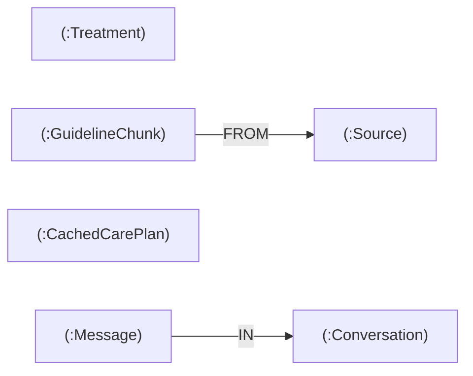

Constraints and indexes created at ingest / first cache / first conversation:

- `treatment_id` unique on `Treatment.id`
- vector index `guideline_index` on `GuidelineChunk.embedding` (768-d, cosine)
- `cached_care_plan_key` unique on `CachedCarePlan.key`
- `conversation_id`, `conversation_key`, `message_id`, `message_dedupe_key` unique
- composite indexes on owner/vet Firebase UID with `updatedAt`

There is **no** relationship between `Treatment` and `GuidelineChunk`. Linking is done in the application: Cypher filters the menu; the vector index retrieves prose; the LLM picks ids; the API joins them.

`Conversation` stores display snapshots for tutor, pet, and plan as JSON, but authorization and inbox lookup use first-class verified Firebase UIDs. Existing anonymous nodes are legacy and never appear in authenticated inboxes.

---

## 5. Care-plan pipeline

`POST /v1/care-plan` is a **retrieve-then-rank-then-ground** pipeline. Server-Timing reports `cache`, `embed`, `vector`, `catalog`, `llm`, `post`, `total`.

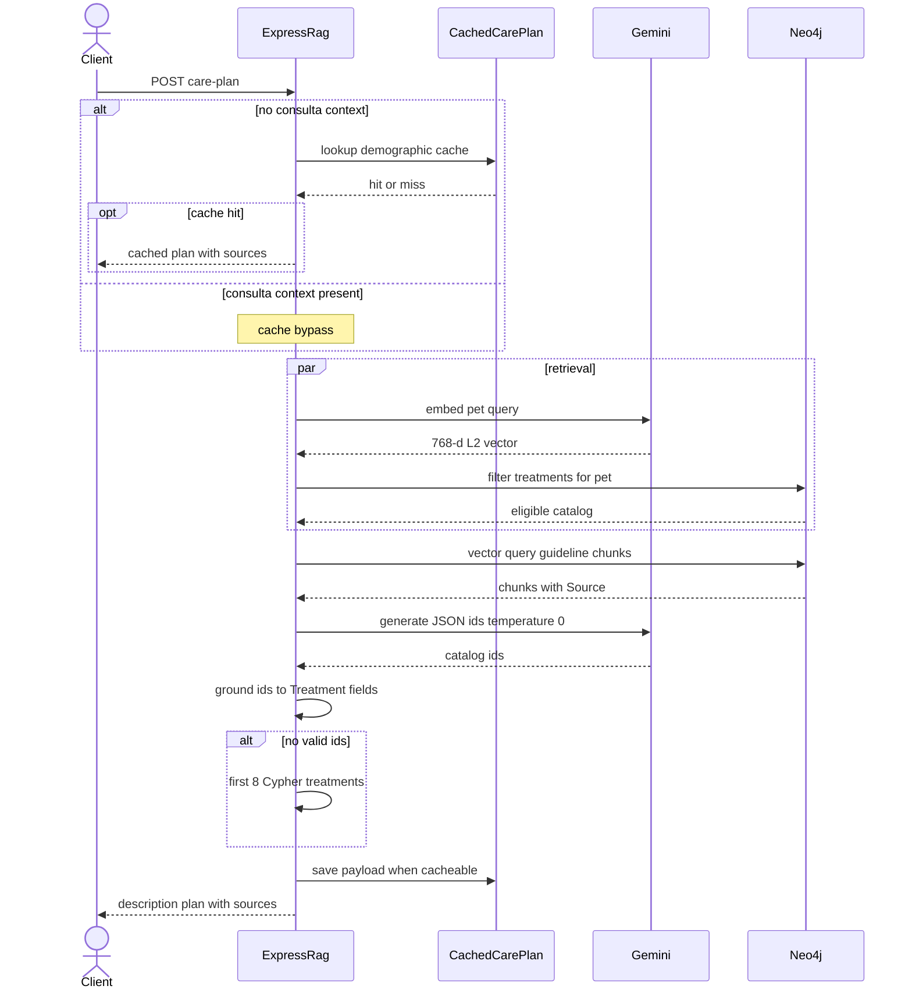

### Query text (embedding)

Built in `buildPetQuery`:

```text
{species} da raça {breed}, {weight}kg, {age} anos, {sexo}, {castrado}
. Resumo da consulta: …
. Diagnóstico: …
. Prescrição: …
. Exames: …
```

Breed docs are written so chunks start with `Cachorro da raça Labrador` / `Gato da raça Persa`, matching that query shape.

### Three grounding layers

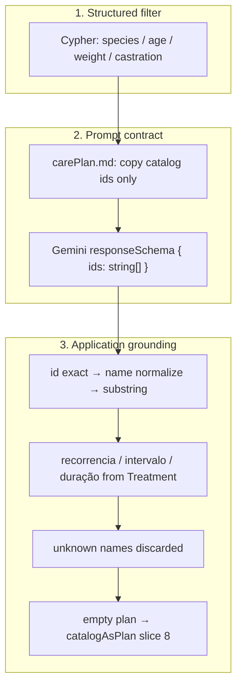

If the catalog filter returns nothing, the API returns **HTTP 502**. That is intentional: better to fail than to invent a menu.

---

## 6. Ingest pipeline

Knowledge is files on disk, not a crawl. `scripts/harvest-allowlist.mjs` only prints URLs on an allowlist.

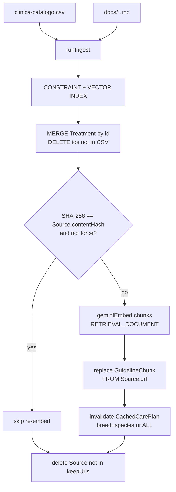

Chunking: split on blank lines, drop parts ≤ 40 characters. Typical file: 4–7 blocks, 80–500 characters.

Cache policy:

- Breed doc (`raca` + `especie` in front-matter) deletes `CachedCarePlan` for that pair.
- Global guideline (WSAVA, AAHA, antirrábica, dermatite) deletes **all** cached plans.

`POST /v1/ingest` with `{ "force": true }` re-embeds everything. Incremental ingest does **not** wipe the graph.

---

## 7. Conversation (care invite)

The care plan is generated first. The invite is a **second product**: the clinic already chose the next-month slice; the model must not enlarge it.

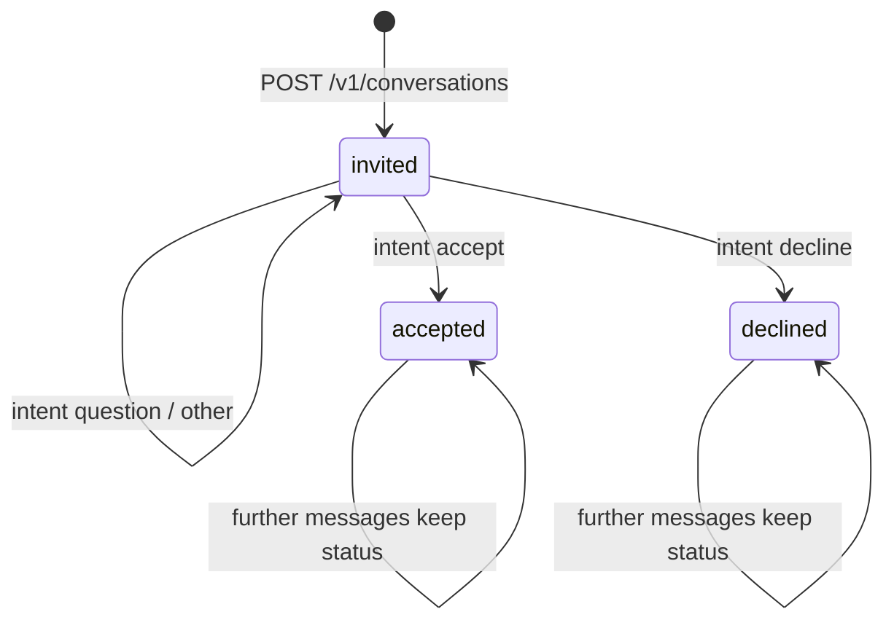

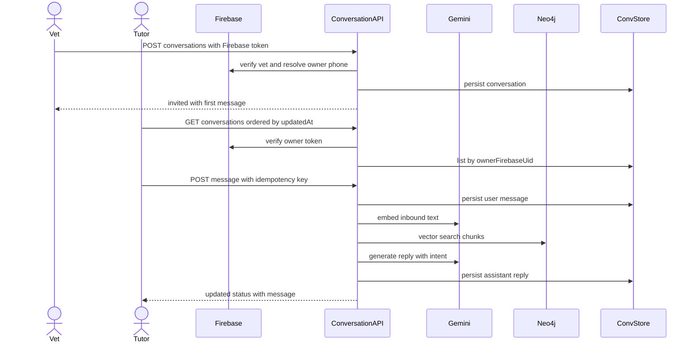

The email/password Firebase identity is the vet; the phone Firebase identity is the tutor. Every thread stores exactly one of each. Channels `whatsapp` / `telegram` remain reserved; adapters are not implemented.

---

## 8. Deployment (current)

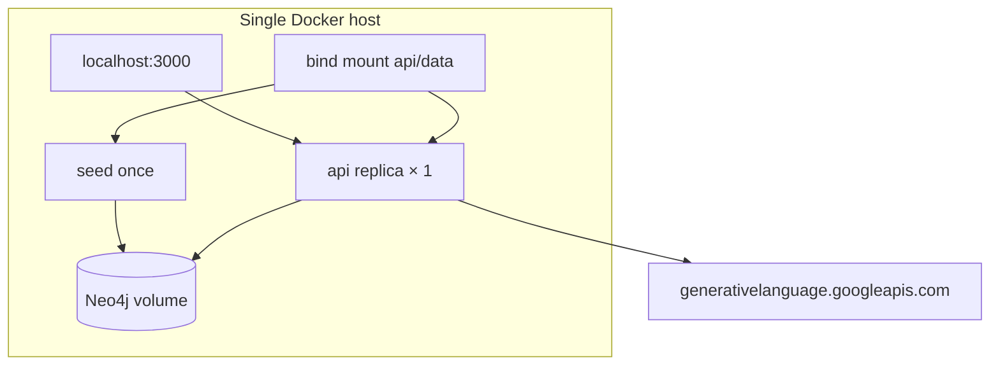

| Concern | POC choice |
| --- | --- |
| Auth | None |
| Multi-clinic | Single catalog |
| HA | None; API waits for seed then serves |
| Secrets | `.env` / Compose `env_file` |
| Observability | `console.log` + `Server-Timing` |
| Rate limits / retries | None around Gemini |
| Horizontal API | Not designed; cache and ingest share the same process |

---

## 9. Why this shape does not scale

The POC is the right size to prove GraphRAG **grounding**. These limits show up as soon as traffic, clinics, or corpus grow.

| Bottleneck | Why it hurts |
| --- | --- |
| **LLM on every miss** | Embed + `generateContent` sit on the HTTP thread. Latency, Gemini quota, and 502s couple to user-facing APIs. |
| **One Neo4j for everything** | Vector kNN, catalog MATCH, cache MERGE, and chat append share CPU, memory, and the same Community instance. Chat JSON blobs compete with ANN. |
| **Ingest on the API** | `POST /v1/ingest` embeds files in-process. A large reindex stalls care-plan traffic. |
| **Seed gates startup** | API cannot start until seed succeeds. Redeploys wait on Gemini. |
| **Coarse cache key** | Exact `weight` and `age` → near-zero reuse across similar pets. Global docs wipe the entire cache. |
| **Unfiltered vector search** | `queryNodes` is global; species/breed are not predicates on chunks. Noise grows with corpus size. |
| **No Treatment–chunk edges** | GraphRAG is “graph filter + vector”, not a true neighborhood expansion. Harder to explain “why this vaccine” from the graph alone. |
| **Sequential ingest writes** | One Cypher `CREATE` per chunk; embeddings batched at 16. Fine for ~8 markdown files, not for hundreds. |
| **No tenant isolation** | One CSV, one index, one cache namespace. |
| **Conversation as properties** | Cannot query “all Labrador invites last week” without parsing JSON; no TTL, no archival. |
| **Single replica, pool 10** | Session-per-query; no queue; no backpressure when Gemini slows. |
| **Sync channels** | WhatsApp webhooks need idempotency, retries, and a worker, not a blocking Express handler. |

---

## 10. Proposed scalable architecture

Keep the **grounding contract**. Change **where work runs**, **which store owns which workload**, and **when the LLM is called**.

### 10.1 Target context

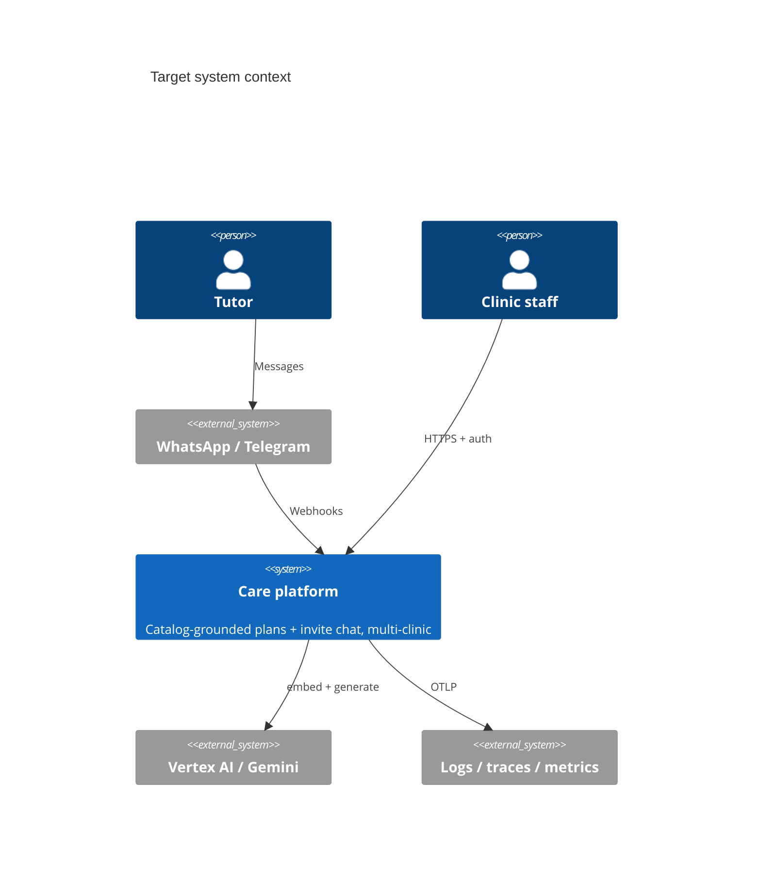

### 10.2 Target containers

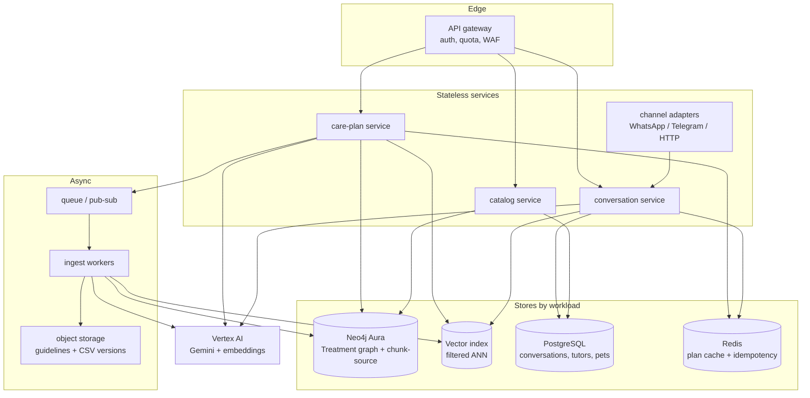

| Piece | Replaces | Why |
| --- | --- | --- |
| **API gateway** | Naked `:3000` | Auth (clinic API keys / JWT), per-tenant rate limits, request id |
| **care-plan service** | `rag.js` inside the monolith | Horizontally scalable; no ingest; timeout + circuit breaker to Vertex |
| **conversation service** | `conversation.js` + Neo4j JSON | OLTP in Postgres; adapters own webhooks; idempotency on `providerMessageId` |
| **catalog service** | CSV bind-mount | Versioned menu per clinic; stable ids; publish event on change |
| **ingest workers** | `POST /v1/ingest` on the API | Re-embed off the request path; hash skip stays |
| **Neo4j Aura** | Local Community | HA; keep **applicability** graph and `(:Chunk)-[:FROM]->(:Source)` |
| **Dedicated vector index** | Same Neo4j ANN as chat/cache | Vertex AI Vector Search, pgvector, or Neo4j only if isolated from OLTP. Filter by `especie` / `raca` / `tenantId` at query time |
| **PostgreSQL** | `Conversation`/`Message` nodes | Threads, status, indexing, retention |
| **Redis** | `CachedCarePlan` nodes | TTL, bucketed demographic keys, tenant prefix, pub/sub invalidation |
| **Object storage** | Git-only `docs/*.md` as runtime source | Clinics upload; workers pull; SHA-256 still skip re-embed |

### 10.3 Stronger GraphRAG (same invariant)

Today the “graph” half is a `WHERE` on `Treatment`. A scalable version can still **forbid invention** while using edges for retrieval quality:

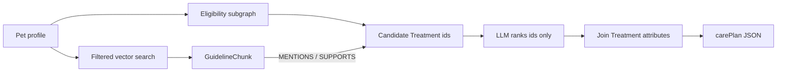

Suggested edges (optional, additive):

- `(:GuidelineChunk)-[:MENTIONS]->(:Treatment)` when the paragraph cites the **exact CSV name**.
- `(:Source)-[:APPLIES_TO {especie, raca?}]->(:BreedProfile)` so ANN can be constrained before kNN.
- `(:Clinic)-[:OFFERS]->(:Treatment)` for multi-tenant menus.

The LLM still returns **ids ⊆ eligible set**. Recurrence still comes from `Treatment`.

### 10.4 Cache that actually hits

Replace exact weight/age in the SHA key with **buckets** (for example age bands and weight quartiles used by the catalog itself). Include `catalogVersion` and `embedModel` in the key so ingest invalidates precisely.

Consulta context (`diagnostico`, etc.) should use a **second cache** keyed by normalized diagnosis tokens + eligible treatment set, with a short TTL — not a full bypass forever.

### 10.5 Request path under load

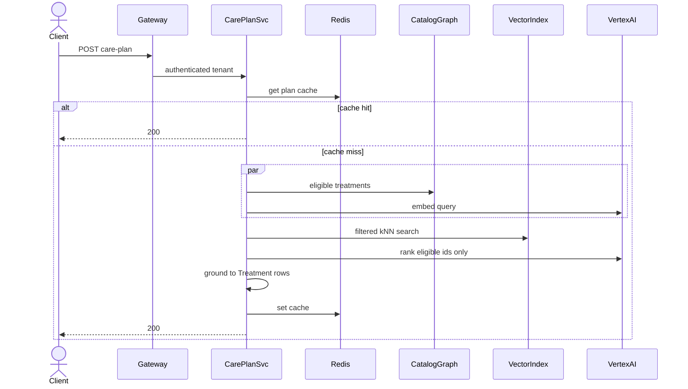

Workers, not the HTTP process, own ingest:

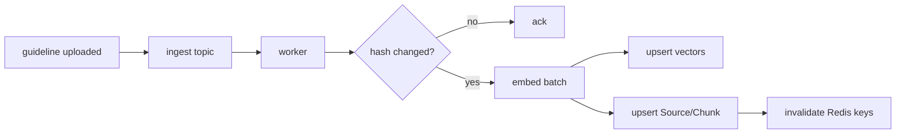

### 10.6 Channels

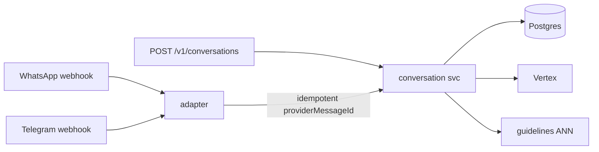

Adapters translate provider payloads into the existing `{ tutor, pet, carePlan }` / inbound text contract. The engine stays channel-agnostic — same as today’s `channel` enum, but with a queue so webhook timeouts do not wait on Gemini.

---

## 11. Comparison

| Dimension | POC (this repo) | Scalable target |
| --- | --- | --- |
| Process model | One Express + one Neo4j + one-shot seed | Gateway + 3 services + ingest workers |
| Catalog | CSV on disk | Versioned catalog service, per clinic |
| Guidelines | Markdown volume | Object storage + async embed |
| Retrieval | Global cosine k=8 | Filtered ANN + optional MENTIONS edges |
| Planner | Gemini ids + app grounding | Same contract; optional rules pre-rank |
| Cache | Neo4j node, exact demographics | Redis, buckets, catalog version |
| Chat | Neo4j JSON properties | Postgres + idempotent webhooks |
| LLM | Sync REST, no retry | Vertex, retries, circuit breaker, timeouts |
| Multi-tenant | No | `tenantId` on catalog, vectors, cache, chat |
| Startup | Blocked on seed | API healthy with last good index; ingest continues |
| Auth / quota | No | Gateway |
| Observability | Server-Timing | Traces per span: cache, embed, vector, llm, ground |

---

## 12. Migration (do not rewrite first)

The POC already has the hard part: **id-only generation + Treatment grounding**. Move in slices.

1. **Extract catalog reads** behind `findTreatmentsForPet` (already a seam). Serve the same CSV via an in-process module, then a service.
2. **Move conversations to Postgres** using `createNeo4jConversationStore` as the interface (`create` / `get` / `appendMessage` / `updateStatus`).
3. **Put ingest on a worker**; keep `runIngest` as the library. API `POST /v1/ingest` enqueues `{ force }`.
4. **Add Redis** in front of `getCachedCarePlan` / `saveCachedCarePlan` with bucketed keys.
5. **Filter vector search** by `especie` (and `raca` when present on `Source`) before or inside ANN.
6. **Run API replicas** once Neo4j (Aura) and Redis are shared and ingest is off-box.
7. **Channel adapters** last; persist `providerMessageId` unique per channel.

Invariant to preserve at every step: if the model emits an unknown id, the item is dropped; if nothing remains, use the Cypher/catalog eligible set or fail closed — never a free-text treatment name.
